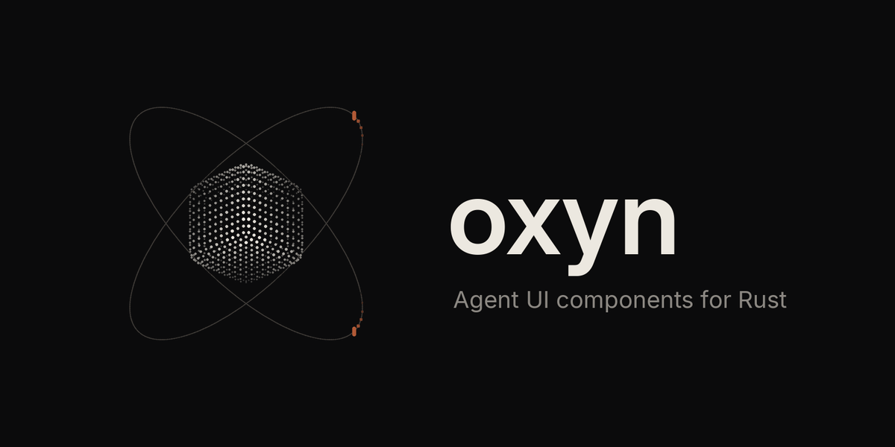

<p align="center">
  
</p>

<h1 align="center">Oxyn</h1>

<p align="center">
  <b>Agent UI components for Rust.</b><br/>
  Composers, thinking states, loaders, tool calls, approvals, diffs, checkpoints and full agent-app shells —<br/>
  with many variants per component and a Studio to tune them live.
</p>

<p align="center">
  <a href="docs/vision.md">Vision</a> ·
  <a href="docs/component-taxonomy.md">Components</a> ·
  <a href="docs/specs/composer-send-control.md">Composer spec</a> ·
  <a href="docs/website-stack.md">Website stack</a> ·
  <a href="docs/roadmap.md">Roadmap</a> ·
  <a href="CONTRIBUTING.md">Contributing</a>
</p>

---

> **Status: research & design baseline.** No component code yet. This repo currently holds the
> product docs, specs, roadmap and brand assets. Development starts when research phase V2-R closes
> (see [roadmap](docs/roadmap.md)).

## What Oxyn is

AI agent apps (coding agents, CRM agents, finance agents, video agents, app builders, voice agents)
share a new kind of interface: a composer that can **stop, queue and steer**, a thinking indicator that
says *what* the agent is doing, tool calls that wait for approval, diffs, checkpoints, sub-agent trees,
and live/voice surfaces. Most UI kits ship one design of each, for React only.

Oxyn is a **Rust-first** library of those pieces:

- **Depth, not breadth alone.** Every component ships in multiple variants
  (compact / inline / card / panel) × surfaces (chat, IDE, desktop, mobile, voice) × motion levels
  (none, subtle, expressive).
- **One agent state model.** A single `AgentState` drives every border, chip, orb, caret and label:
  `idle → composing → submitted → thinking → streaming → tool_running → awaiting_approval → done | error | cancelled | stalled`.
- **Activity-aware.** Loaders come with verb packs ("searching", "reading", "patching") and
  reduced-motion fallbacks built in.
- **Category kits.** Ready shells and dashboards per agent vertical: coding, CRM, finance, video,
  app builder, support, research, voice — each assembled only from Oxyn parts.
- **Studio.** Click any part of a component, tune tokens, props and motion, simulate an agent run on a
  timeline, then export Rust source or a CLI preset with a shareable link.

## Planned packages

| Crate / app | Role |
|---|---|
| `oxyn-core` | Framework-free: agent state machine, streaming model, verb packs, motion presets |
| `oxyn-tokens` | Design tokens (JSON → Rust theme, CSS variables, GPUI theme) |
| `oxyn-gpui` | Components for GPUI desktop apps (primary target) |
| `oxyn-dioxus` | Components for Dioxus (web demos, web apps) |
| `oxyn-codegen` | Shared code generator used by the CLI and the Studio |
| `oxyn-cli` | `oxyn add <component>` — shadcn-style copy-paste installer (free + Pro registry) |
| `site/` | Docs, gallery and Studio (Astro + Starlight + Rust→WASM demos) |

Details: [docs/architecture.md](docs/architecture.md) and [docs/website-stack.md](docs/website-stack.md).

## Repository layout (today)

```
.
├─ README.md                 you are here
├─ docs/
│  ├─ vision.md              positioning, principles, who it's for
│  ├─ architecture.md        crates, state model, adapters
│  ├─ component-taxonomy.md  every component family + agent-app categories
│  ├─ variants.md            how variants are defined and named
│  ├─ specs/                 deep specs (composer send control first)
│  ├─ website-stack.md       site, docs, Studio, registry, payments, hosting
│  ├─ studio.md              Studio UX blueprint
│  ├─ roadmap.md             baseline + V2 phases
│  ├─ licensing.md           licence and attribution rules for references
│  └─ research/              reference index (sites, apps, creators)
├─ assets/brand/             logo, banner, render script
└─ .github/                  PR + issue templates, CODEOWNERS
```

## Working on Oxyn

Two maintainers, one rule set. Every change goes through a branch and a pull request; every commit
credits both maintainers with a `Co-authored-by:` trailer. See [CONTRIBUTING.md](CONTRIBUTING.md).

## Licence

Oxyn's open core is [MIT](LICENSE). A paid Pro tier (extra variants, category kits, Studio extras) is
planned and will be licensed separately. Code ported from third-party projects keeps its original
MIT / Apache-2.0 notice — see [docs/licensing.md](docs/licensing.md).

<sub>Built by <a href="https://github.com/ismailqureshi72">@ismailqureshi72</a> and <a href="https://github.com/Khubaib7-del">@Khubaib7-del</a>.</sub>
